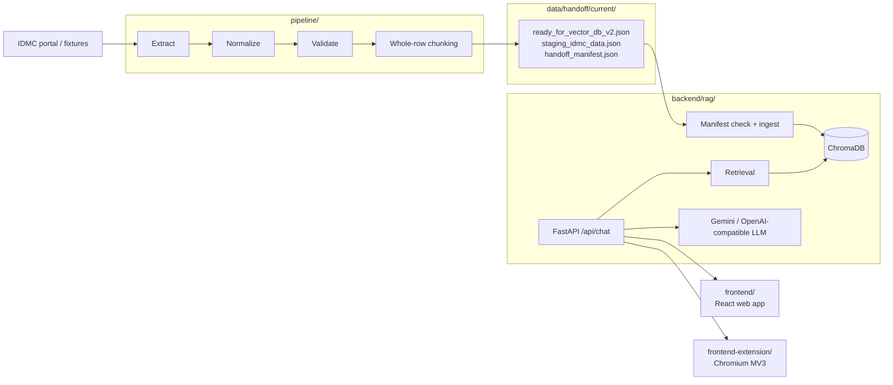

# IDMC Chatbot

**Citation-first RAG assistant for the IDMC / Portal Data Publik DIY open-data portal.**

[](https://www.python.org/)
[](https://nodejs.org/)
[](https://react.dev/)
[](https://fastapi.tiangolo.com/)
[](https://www.trychroma.com/)

IDMC Chatbot turns the dashboards and charts published on the IDMC portal into a
searchable knowledge base, then answers natural-language questions with evidence:
the dashboard and chart name, the row range used, and the data date. It is a
monorepo containing the extraction pipeline, the RAG backend, a standalone web
client, and a Chromium browser extension.

The project is designed around one boundary: the pipeline produces a validated
JSON handoff and stops there. Only the backend embeds chunks, writes the vector
index, and calls an LLM.

## Highlights

- **Grounded answers.** Substantive replies are rebuilt from retrieved passages
  and end with a source block. Model-invented citations are discarded.
- **Deterministic ingestion.** The pipeline emits whole-row chunks plus a
  SHA-256 manifest; the backend validates the manifest before indexing.
- **Incremental by default.** Content hashes prevent unchanged chunks from being
  re-embedded. `--reindex` rebuilds the active collection from scratch.
- **Two delivery surfaces.** A standalone React web app and a Manifest V3
  extension that injects the chatbot into the portal.
- **Offline testability.** Synthetic fixtures cover the pipeline and integration
  path without portal cookies or live services.

## Architecture



## Repository layout

| Path | Responsibility |
| --- | --- |
| `backend/rag/` | FastAPI service: manifest validation, embedding, Chroma indexing, retrieval, chat, sessions, and HTTP API. |
| `pipeline/` | Source discovery, extraction, normalization, validation, delta detection, and whole-row chunking. Stops at JSON. |
| `frontend/` | Standalone React + Vite chat UI with source cards and server-backed session history. |
| `frontend-extension/` | WXT-powered Chromium Manifest V3 extension for the IDMC portal. |
| `data/handoff/current/` | Committed sample handoff bundle used to bootstrap a local index. |
| `docs/` | Cross-component runbook and design notes. |
| `scripts/` | `validate_integration.py`, the offline end-to-end smoke test. |

Local-only directories such as `node_modules/`, `dist/`, `.output/`, `.wxt/`,
`legacy/`, `data/backups/`, live-run handoffs, and vector databases are excluded
by `.gitignore`.

## Tech stack

| Layer | Stack |
| --- | --- |
| Pipeline | Python 3.12+ (pinned target), `requests`, `tenacity`, optional Playwright for browser sources |
| Backend | Python 3.13, FastAPI, Uvicorn, ChromaDB, `google-genai`, Pydantic |
| Web client | React 19, TypeScript, Vite, Tailwind CSS 4, `react-markdown` + `remark-gfm` |
| Browser extension | WXT, Manifest V3, React, TypeScript, Tailwind CSS |
| Testing | pytest, unittest, Node test runner, Playwright |

## Getting started

### Prerequisites

- **Python 3.13** for the backend. The pipeline targets Python 3.12 and is also
  validated on 3.13.
- **Node.js 22** and npm 10.
- A **Gemini API key** for embeddings and chat.
- **Chrome or Edge 120+** if you want to run the extension.
- Portal session cookies only for live crawls. Offline tests do not need them.

The examples below use POSIX shell syntax. On Windows PowerShell, use
`Copy-Item` instead of `cp`, and the `py` launcher where `python` is unavailable.

### 1. Clone and configure

```bash
git clone https://github.com/hisyamardnsyahx/idmc-chatbot.git
cd idmc-chatbot
cp .env.example .env
```

Set `GEMINI_API_KEY` in `.env`. The full backend configuration reference is in
[`backend/rag/.env.example`](backend/rag/.env.example).

For live portal crawls, also create the pipeline environment file:

```bash
cp pipeline/.env.example pipeline/.env
```

### 2. Install and seed the backend

```bash
cd backend
python -m pip install -r rag/requirements.txt
python -m rag.ingest_from_staging \
  --source ../data/handoff/current/ready_for_vector_db_v2.json \
  --reindex
python -m rag.ingest_from_staging --stats
```

`--reindex` clears the active collection before loading the bundle. Without it,
only chunks whose `content_hash` changed are re-embedded.

### 3. Run the backend

```bash
cd backend
python -m uvicorn rag.web.app:app --host 127.0.0.1 --port 8001
```

- Chat UI: <http://127.0.0.1:8001/>
- OpenAPI docs: <http://127.0.0.1:8001/docs>

### 4. Run the web client

In a second terminal:

```bash
cd frontend
npm ci
npm run dev
```

Open <http://localhost:5173>. Vite proxies `/api` to `http://127.0.0.1:8001`.

### 5. Build the browser extension (optional)

```bash
cd frontend-extension
npm ci
cp .env.example .env.local
```

Set `WXT_CHAT_API_URL` to the full chat endpoint, including `/api/chat`:

```dotenv
# Local development
WXT_CHAT_API_URL=http://127.0.0.1:8001/api/chat

# Production
WXT_CHAT_API_URL=https://rag.example.org/api/chat
```

Then build and load the extension:

```bash
npm run build
```

Open `chrome://extensions` or `edge://extensions`, enable developer mode, choose
**Load unpacked**, and select `.output/chrome-mv3`. Production builds require
HTTPS; loopback HTTP is allowed only in development/test builds.

### 6. Run the pipeline (optional)

The committed handoff bundle is enough to run the backend. Use the pipeline when
you need fresh portal data:

```bash
cd pipeline
python -m venv .venv
source .venv/bin/activate          # Windows: .\.venv\Scripts\Activate.ps1
python -m pip install -r requirements.txt
python -m pip install -r requirements-looker.txt
python -m playwright install chromium --only-shell
cp .env.example .env
python -B main_orchestrator.py --output-dir runtime/live-v2
```

Browser dependencies are only required for Looker, Tableau, and other
browser-rendered sources. See [`pipeline/README.md`](pipeline/README.md) for
production TLS, cookie, and source-specific configuration.

## Refreshing the knowledge base

1. **Crawl** into a dedicated output directory:
   ```bash
   cd pipeline
   python -B main_orchestrator.py --output-dir runtime/live-v2
   ```
   The pipeline writes `handoff_manifest.json` last. Do not consume the bundle
   while the job is still running.

2. **Publish** the complete bundle (all five files) to the active handoff:
   ```bash
   cd ..
   cp pipeline/runtime/live-v2/* data/handoff/current/
   ```
   Keep the manifest consistent with the payload files.

3. **Ingest** from the backend:
   ```bash
   cd backend
   python -m rag.ingest_from_staging \
     --source ../data/handoff/current/ready_for_vector_db_v2.json \
     --reindex
   python -m rag.ingest_from_staging --stats
   ```

4. **Restart** the backend if you changed index or provider settings.

For an incremental refresh, omit `--reindex`; only changed `content_hash`
values are re-embedded.

## API surface

| Method | Endpoint | Purpose |
| --- | --- | --- |
| `GET` | `/` | Built-in chat UI |
| `POST` | `/api/chat` | Chat with retrieval and function calling |
| `POST` | `/chat` | Backward-compatible chat alias |
| `POST` | `/api/search` | Direct retrieval |
| `GET` | `/api/charts` | Chart catalog |
| `GET` | `/api/sessions` | List sessions |
| `GET` | `/api/sessions/{id}` | Load one session |
| `DELETE` | `/api/sessions/{id}` | Delete a session |
| `GET` | `/api/health` | Health check |
| `GET` | `/api/stats` | Index and collection statistics |

The chat response includes `session_id`, `reply`, `reply_format`, and a structured
`sources` array.

## Configuration

| Variable | Location | Default | Purpose |
| --- | --- | --- | --- |
| `GEMINI_API_KEY` | `.env` | — | Required for embeddings and Gemini chat |
| `GEMINI_MODEL` | `.env` | `gemini-3.8-flash` | Primary chat model |
| `EMBED_MODEL` | `.env` | `gemini-embedding-2` | Embedding model |
| `VECTOR_COLLECTION` | `.env` | `rag_web_gemini-embedding-2_v2` | Active Chroma collection |
| `CHAT_PROVIDER` | `.env` | `gemini` | `gemini` or `openai-compat` |
| `CHAT_BASE_URL`, `CHAT_API_KEY` | `.env` | — | OpenAI-compatible chat provider settings |
| `RAG_TOP_K` | `.env` | `5` | Default retrieval depth |
| `VECTOR_MIN_SCORE` | `.env` | `0.68` | Minimum cosine similarity |
| `DWH_COOKIE_*` | `pipeline/.env` | — | Optional Superset fallback cookies |
| `WXT_CHAT_API_URL` | `frontend-extension/.env.local` | — | Full chat endpoint for the extension |

See [`backend/rag/.env.example`](backend/rag/.env.example) and
[`pipeline/.env.example`](pipeline/.env.example) for the complete reference.

## Testing

| Scope | Command |
| --- | --- |
| Backend | `cd backend && python -m pytest -q` |
| Pipeline | `cd pipeline && python -B -m unittest discover -s tests -v` |
| Web client | `cd frontend && npm test && npm run typecheck && npm run lint && npm run build` |
| Extension | `cd frontend-extension && npm test && npm run typecheck` |
| Integration smoke test | `python scripts/validate_integration.py` |

The pipeline and integration suites use synthetic fixtures. They do not require
portal cookies, a production snapshot, or a live LLM.

## Current index state

The committed sample bundle was ingested locally with `gemini-embedding-2`:

- **Active collection:** `rag_web_gemini-embedding-2_v2` — 507 chunks, 74
  charts, and 20 dashboards.
- **Rollback collection:** `rag_web_gemini-embedding-2` — 229 chunks from v1.
- **Last live crawl:** 2026-10-22, partial: 74 records, 507 chunks, two CCTV
  validation failures, valid manifest.

Chroma databases are intentionally not committed. Run the ingestion step after
cloning to build the index locally.

## Security and operational notes

- Never commit `.env` files, portal cookies, API keys, or session tokens.
- The backend has **no authentication**. The session list is global; do not expose
  the service publicly without adding authentication and per-user isolation.
- The browser extension sends only submitted questions to the configured backend.
  It does not read portal authentication, scrape portal data, or persist chats.
- Production extension builds require HTTPS and narrowly scoped host permissions.
- CORS defaults are limited to local Vite development origins.

## Limitations

- Source coverage is intentionally partial. Some dashboards are metadata-only or
  expose non-tabular visuals; Tableau detail exports and custom Grafana panels are
  unsupported.
- The last live crawl was partial; known gaps are documented in
  [`pipeline/docs/FINAL_VALIDATION.md`](pipeline/docs/FINAL_VALIDATION.md).
- Chat responses are not streamed. The extension uses a 25-second request timeout.
- The extension targets Chromium only; Firefox and Safari are out of scope.
- Sessions and the vector store are local, single-node resources.

## Documentation

| Document | Contents |
| --- | --- |
| [`docs/INTEGRATION.md`](docs/INTEGRATION.md) | Full runbook: pipeline, ingest, backend, frontend, configuration, and troubleshooting |
| [`backend/rag/docs/ARCHITECTURE.md`](backend/rag/docs/ARCHITECTURE.md) | Backend layering and module responsibilities |
| [`backend/rag/docs/OPERATIONS.md`](backend/rag/docs/OPERATIONS.md) | Index operations and error handling |
| [`pipeline/docs/BACKEND_HANDOFF.md`](pipeline/docs/BACKEND_HANDOFF.md) | Handoff contract and manifest rules |
| [`frontend/README.md`](frontend/README.md) | Web client development guide |
| [`frontend-extension/README.md`](frontend-extension/README.md) | Extension setup, permissions, and test workflow |

## License

No license has been declared for this repository. Contact the maintainer before
reusing the code or data outside this project.
